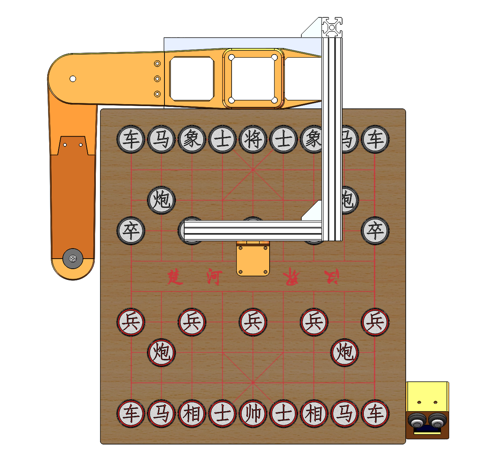
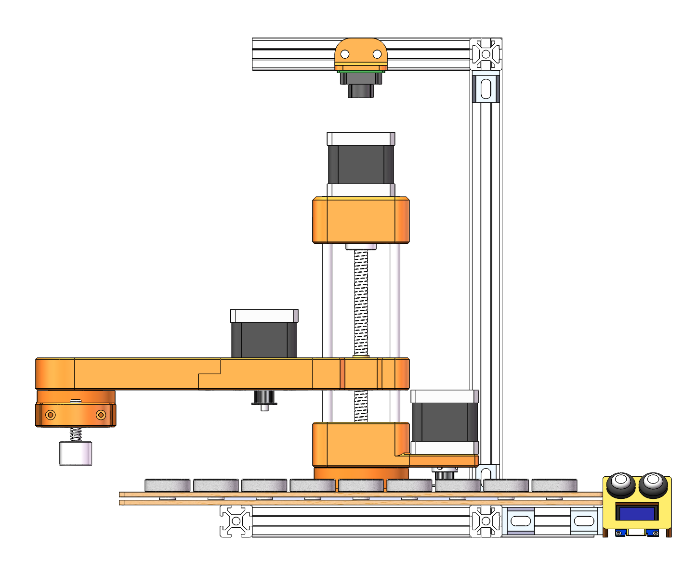
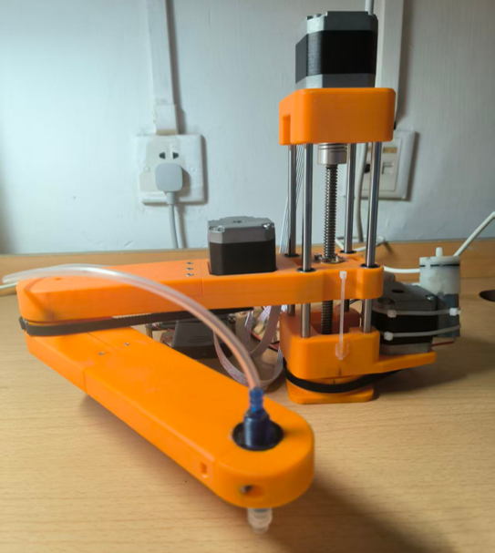
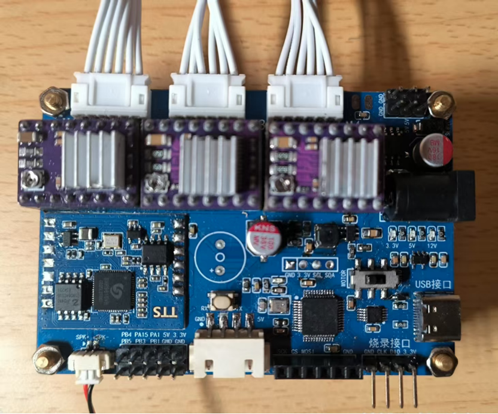
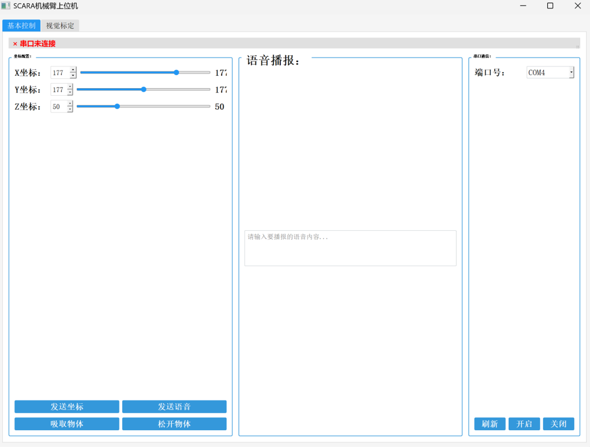
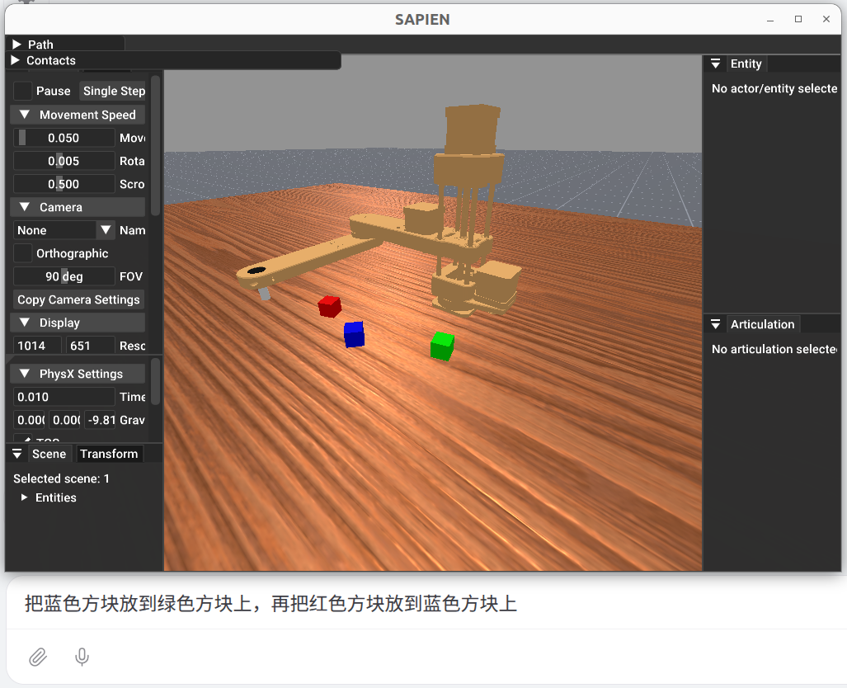
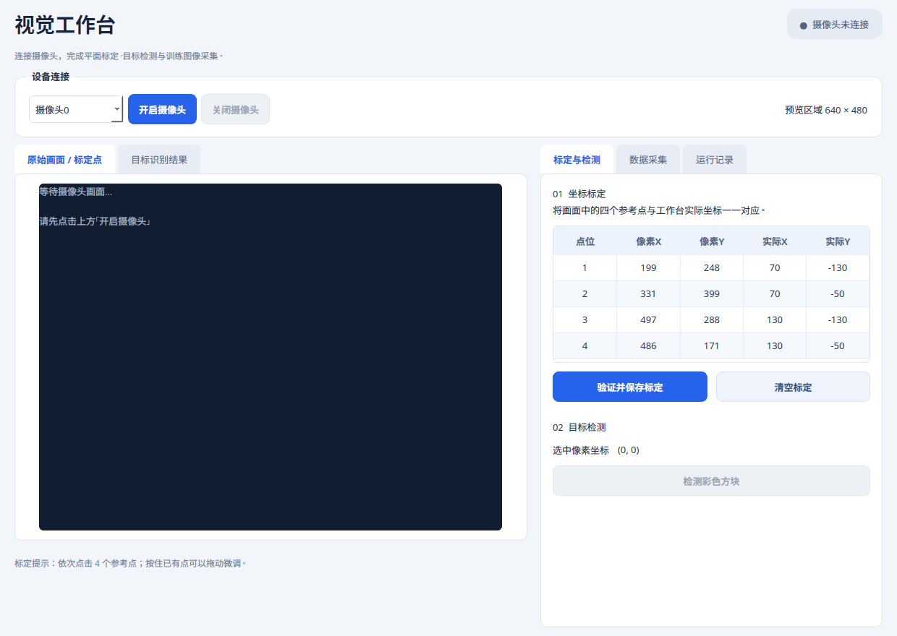
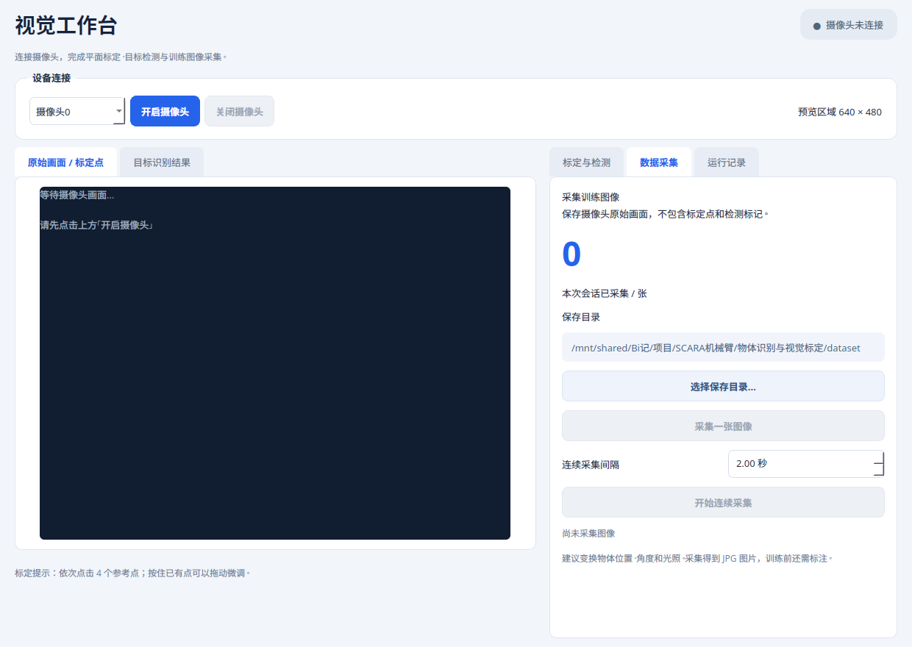

# 下棋机器人：三轴 SCARA 机械臂控制系统

本项目是下棋机器人，包含三轴 SCARA 机械臂的 STM32 下位机固件、Qt 串口上位机、Python 视觉标定与图像采集上位机，以及机械结构模型和设计文档。系统支持笛卡尔坐标运动、PS2 手柄控制、末端气泵取放和语音播报。

## 项目效果图

以下为三维模型中的整机装配视图：

| 整机俯视效果 | 整机正视效果 |
| --- | --- |
|  |  |

真实照片：



驱动电路板：



上位机照片：



​	仿真照片：



## 功能概览

- **三轴 SCARA 运动控制**：下位机执行平面双连杆与 Z 轴运动学解算，将末端坐标转换为步进电机运动。
- **串口上位机控制**：通过 Qt 桌面程序选择串口、设置末端坐标、发送语音文本以及控制工具取放。
- **视觉标定与数据采集**：通过四点平面标定完成像素到实际坐标的转换，支持 YOLO 彩色方块检测、单张及定时图像采集。
- **PS2 手柄遥控**：下位机读取手柄输入，支持直接控制机械臂末端及工具。
- **末端工具控制**：驱动气泵完成物块吸取和放下；固件配置中当前选择气泵方案。
- **语音播报**：通过串口向 SNR9816 模块发送文本。
- **机械结构与硬件资料**：提供机械臂、棋盘、PCB 等模型文件和设计笔记。

## 系统组成

| 部分 | 说明 |
| --- | --- |
| 下位机 | STM32F103C8，基于 STM32F10x 标准外设库；负责串口协议解析、运动学解算、三路步进电机、工具、PS2 和语音模块控制。 |
| 上位机 | Qt Widgets/C++ 桌面程序，使用 Qt SerialPort；提供串口连接、坐标控制、文本播报和工具控制。 |
| 视觉上位机 | Python/PyQt5 桌面程序，使用 OpenCV 和 YOLO；提供四点平面标定、目标定位与训练图像采集。 |
| 机械结构 | 三轴 SCARA 机械臂，主、副臂长度参数各为 177 mm；步进电机经传动机构驱动。 |
| 驱动与供电 | 设计资料中包含 DRV8825 步进电机驱动、12 V 主电源及控制/语音模块供电方案；以实际装配和电路版本为准。 |

## 目录结构

```text
.
├── GUI/                         # Qt/C++ 上位机工程
│   ├── scara_HMI.pro             # qmake 工程文件
│   ├── mainwindow.*              # 界面与串口操作
│   └── roboticarm.*              # 上位机数据包封装
├── 物体识别与视觉标定/           # Python 视觉工作台
│   ├── main.py                  # 标定、检测和数据采集主界面
│   ├── get_object_pose.py       # 独立目标坐标检测脚本
│   ├── dataset_collect.py       # 保留的独立图像采集工具
│   ├── best.pt                  # YOLO 模型权重
│   ├── camera_parama.txt        # 四组像素与实际坐标对应点
│   ├── data.yaml                # 数据集路径与类别配置
│   └── dataset/                 # 采集时自动创建的默认图像目录
├── 下位机代码/                   # STM32 下位机工程
│   ├── Project.uvprojx            # Keil µVision 工程
│   ├── User/                      # main 与中断入口
│   ├── Hardware/                  # GPIO、串口、电机、语音等底层驱动
│   ├── Software/                  # SCARA 运动学、步进电机与协议逻辑
│   ├── Library/                   # STM32F10x 标准外设库
│   └── 通讯格式.txt               # 串口协议简表
├── URDF模型/                     # URDF 与网格模型
├── 三维模型/                     # 机械臂、棋盘及电路板等三维设计文件
└── 设计笔记/                     # 硬件与机械设计记录
```

## 构建与运行

### Qt 上位机

依赖：

- Qt 6（工程使用 C++17）
- Qt SerialPort 模块
- 与 Qt 套件匹配的 C++ 编译器（仓库现有构建目录对应 Qt 6.7.3 / MSVC 2019 64-bit Debug）

使用 Qt Creator 打开 [`GUI/scara_HMI.pro`](GUI/scara_HMI.pro)，选择已安装的桌面 Qt 套件，确认安装并启用 Qt SerialPort 后构建、运行。连接设备前，先通过界面刷新串口列表并选择端口。

上位机串口参数为 **115200 baud、8 数据位、无校验、1 停止位、无流控**。PC 与控制板之间需要使用匹配的 USB 转串口接口，并确保共地及电平兼容。

### STM32 下位机

使用 Keil MDK-ARM / µVision 打开 [`下位机代码/Project.uvprojx`](下位机代码/Project.uvprojx)。工程目标器件配置为 STM32F103C8，并依赖工程内的 STM32F10x 标准外设库。构建后按实际控制板的下载接口和时钟/引脚配置烧录固件。

上电后固件初始化电机、串口、语音模块和 PS2 手柄，并将末端坐标复位到 `X_INIT/Y_INIT/Z_INIT`。机械臂尺寸、减速比、Z 轴丝杆导程、运动范围等参数集中在 `下位机代码/Software/driver_config.h` 中；更改前请核对实际机构和驱动板配置。

> 首次联调请先断开或卸载末端工具，在安全范围内验证坐标和运动方向；坐标复位依赖当前固件设定，不等同于带限位开关的自动寻零。

## 视觉标定与图像采集

视觉模块位于 [`物体识别与视觉标定/`](物体识别与视觉标定/)，使用 Python、PyQt5、OpenCV 和 Ultralytics YOLO。主要入口为 `main.py`，将四点平面标定、彩色方块检测和训练图像采集合并在同一个桌面界面中。

### 环境安装

建议使用独立的 Python 3.10 环境。以下版本与本次界面及模拟采集检查使用的环境一致；完整依赖由 pip 解析安装，仓库暂未提供完整的依赖锁定文件。

在 Anaconda Prompt 或已配置 Conda 的终端执行：

```bash
conda create -n scara-vision python=3.10 -y
conda activate scara-vision
python -m pip install --upgrade pip
python -m pip install "numpy==2.2.6" "opencv-python==4.13.0.92" "PyQt5==5.15.7" "ultralytics==8.4.37"
```

Ultralytics 会引入 PyTorch 等推理依赖。采集和标定不要求 NVIDIA 显卡，YOLO 可使用 CPU 推理；需要 GPU 加速时，再按显卡驱动和 CUDA 支持情况安装相匹配的 PyTorch。Qt/C++ 上位机的 Qt 6 编译套件与此处的 PyQt5 环境分别使用，无需为运行 Python 界面编译 `GUI/` 工程。

安装后检查主要模块是否可导入：

```bash
python -c "import cv2, numpy, torch, ultralytics; from PyQt5 import QtWidgets, QtSerialPort; print('SCARA vision environment OK')"
```

使用带桌面显示的系统，并连接可用的 USB 摄像头。运行检测前，确认视觉目录内包含 `best.pt`；只做预览或采集时，程序不会加载该模型。

### 启动视觉上位机

从仓库根目录执行，Windows 和 Linux 均可使用以下相对路径：

```bash
conda activate scara-vision
cd "物体识别与视觉标定"
python main.py
```

窗口名称为“视觉工作台 · 标定与数据采集”。左侧提供“原始画面 / 标定点”和“目标识别结果”两个预览页；右侧包含“标定与检测”“数据采集”“运行记录”三个功能页。

**视觉上位机：标定与检测界面**



截图为当前程序启动后的界面，尚未连接摄像头；右侧表格显示从标定文件读取的坐标。

1. 在顶部选择 `摄像头0`、`摄像头1` 或 `摄像头2`，点击“开启摄像头”。
2. 确认预览正常，状态显示“摄像头已连接”；索引与具体摄像头的对应关系由系统决定。
3. 切换相机前先点击“关闭摄像头”。不要让其他程序同时占用同一个摄像头。

预览区域为 640 × 480，代码请求摄像头以相同分辨率采集；实际协商分辨率可在“运行记录”中查看。标定时应确认实际采集为 640 × 480，保持摄像头位置、朝向、焦距和分辨率固定。

### 四点平面标定

标定通过四组“图像像素坐标 ↔ 工作台实际坐标”计算透视变换矩阵，将检测到的像素位置换算到工作平面的坐标系。

1. **布置参考点**：在同一个工作平面上选取四个分散的参考点，尽量覆盖目标活动区域，避免三点共线。通过测量或机械臂定位确定每个点的实际 X、Y，单位为毫米；原点和轴方向应与后续使用的机械臂坐标系一致。
2. **准备标定表**：打开右侧“标定与检测”。首次标定或重新布点时，可点击“清空标定”；该按钮会同时清空像素坐标和实际坐标，需要重新填写实际 X、Y。
3. **采集像素坐标**：在左侧“原始画面 / 标定点”中，按点 1～点 4 的顺序点击参考点。像素坐标自动写入表格；按住已有点可拖动微调。每一行的像素坐标必须对应同一个实际参考点。
4. **填写实际坐标**：核对并填写表格的“实际X”“实际Y”，不要直接套用默认值。默认坐标如下，仅适用于参考点确实位于这些位置的布置。
5. **保存**：点击“验证并保存标定”，到“运行记录”确认标定点验证和保存结果。数据保存在视觉目录的 `camera_parama.txt` 中，程序下次启动时读取。

| 点位 | 默认实际 X / mm | 默认实际 Y / mm |
| --- | --- | --- |
| 1 | 70 | -130 |
| 2 | 70 | -50 |
| 3 | 130 | -130 |
| 4 | 130 | -50 |

标定文件每行格式为 `像素X,像素Y,实际X,实际Y`，共四行。例如：

```text
445,323,70,-130
309,324,70,-50
445,221,130,-130
312,220,130,-50
```

当前“验证并保存标定”主要检查像素坐标并保存对应点，实际转换矩阵在目标检测时由 `cv2.getPerspectiveTransform()` 计算。当前代码会将像素 X 或 Y 等于 0 的点视为无效，选点时请避开图像最左侧和最上侧边界。

保存后还应使用未参与标定的已知位置检查定位误差。移动摄像头、改变焦距或采集分辨率，或调整工作平面后，需要重新标定。

### 目标检测与坐标结果

完成标定后，点击“检测彩色方块”，再切换左侧“目标识别结果”查看中心点标记，在右侧“运行记录”和启动终端查看坐标输出。每次点击处理一帧；物体移动后需再次检测。

当前应用处理以下四种方块类别，其编号与 `data.yaml` 对应：

| 目标 | YOLO 类别编号 |
| --- | --- |
| 红色方块 | 0 |
| 绿色方块 | 1 |
| 蓝色方块 | 2 |
| 黄色方块 | 13 |

程序取 YOLO 检测框中心的像素坐标，使用透视变换得到实际 X、Y，再将毫米除以 1000，以米输出。例如，下列示例表示 X = 100 mm、Y = -90 mm：

```text
blue cube 1: [0.100, -0.090, 0.010]
```

第三个数 `0.010` 是代码固定填写的值，不是测得的物体高度；程序也没有估计物体朝向。四点映射适用于标定平面，物体检测中心高于该平面时可能引入位置偏差。

> 标定点不足时，主程序会提示“使用原始像素坐标”，并将像素数值除以 1000 输出。这些数值不能作为实际机械臂坐标使用。接入控制前，应先确认四点对应正确并验证定位精度。

也可在视觉目录中执行独立检测脚本：

```bash
python get_object_pose.py
```

该脚本从当前工作目录读取 `camera_parama.txt` 和 `best.pt`，优先尝试摄像头 0，另有 Windows DirectShow 的摄像头 2 备用分支；设备不匹配时需调整脚本中的相机索引。使用前先关闭主界面的摄像头或退出主程序，释放设备。

### 训练图像采集

**视觉上位机：数据采集界面**



右侧提供保存目录、单张采集、连续采集间隔和本次会话计数；开启摄像头后可使用采集按钮。

无需先做标定即可采集图像：

1. 开启摄像头，切换右侧“数据采集”。
2. 默认目录为视觉目录下的 `dataset/`，也可点击“选择保存目录…”修改。目录不存在时会在保存时创建。
3. 点击“采集一张图像”保存单张图片；或设置“连续采集间隔”（0.5～60 秒，默认 2 秒），点击“开始连续采集”。连续采集在第一个间隔到期后保存首张，再按间隔保存。
4. 连续采集时，可点击“停止连续采集”结束；关闭摄像头或退出程序也会停止。连续采集期间不能更换目录或修改间隔。
5. 查看本次会话的采集数量、最近保存文件名和“运行记录”。数量不统计保存目录中原有的图片；读取摄像头或写入文件失败时，连续采集会停止。

图片以 `image_日期_时间_微秒.jpg` 命名，保存摄像头原始画面，不包含界面标定点和识别标记。采集时可变化物体位置、角度和光照，减少重复画面。

采集只生成图片，不会生成目标框标注或自动训练模型。训练前需另行标注、划分训练/验证/测试集并修改 `data.yaml`：当前配置包含原机器的绝对路径，且训练、验证、测试指向同一个 `images` 目录，不应直接作为新的训练评估划分使用。原独立工具 `dataset_collect.py` 仍保留，日常采集可直接使用 `main.py`。

### 与机械臂控制上位机配合

当前 Python 视觉界面用于标定、检测、采集和坐标输出，尚未提供从检测结果自动抓取的界面流程。操作机械臂仍使用 `GUI/` 中的 Qt/C++ 上位机，串口连接与参数见前文“Qt 上位机”。

联调时先核对两个程序使用的坐标原点和轴方向，将视觉输出的米换算为控制端使用的毫米，并根据实际工具和工作台确定 Z 轴高度；不要直接把固定输出的 `0.010` 作为抓取高度。定位结果验证通过后，再按控制上位机流程执行运动和工具取放。

### 常见问题

| 现象 | 检查方法 |
| --- | --- |
| 提示模块不存在 | 确认已激活 `scara-vision`，使用 `python -m pip` 在同一个环境安装依赖，并运行导入检查命令。 |
| 无法打开摄像头 | 关闭其他占用程序，检查系统相机权限和连接，关闭设备后尝试其他索引；独立脚本需单独核对其相机索引。 |
| 缺少模型或模型加载失败 | 确认 `best.pt` 位于视觉目录；核对模型来源和 Ultralytics/PyTorch 版本。采集不依赖模型加载成功。 |
| 坐标明显错误 | 核对四点顺序、实际坐标的毫米单位和轴方向，检查相机是否移动；确认未出现“使用原始像素坐标”的提示。 |
| 图像保存失败 | 查看“运行记录”，检查保存目录权限、磁盘空间和文件系统是否可写。 |
| Qt 平台插件报错 | 确认在带桌面的环境中运行，并检查是否混入其他 Qt 安装的插件路径；Linux 环境还需具备系统所需的 Qt/xcb 图形库。 |

## 串口协议

多字节坐标使用**大端序**传输，坐标在下位机侧按 `int16_t` 解释；校验和为指定字节求和后取低 8 位。坐标单位按固件中的机械尺寸参数以毫米配置。下列数据包均从上位机发往下位机。

| 包头 | 格式 | 校验/行为 |
| --- | --- | --- |
| `0x55` | `55 X高 X低 Y高 Y低 Z高 Z低 校验` | 校验为包头与 6 个坐标字节之和的低 8 位。下位机执行坐标移动；不可达时返回 `Target position unreachable\r\n`。 |
| `0x66` | `66 文本字节... 00` | 文本以 NUL 结尾，不带校验和。设计协议为 GBK 编码；发送端需与语音模块的字符编码保持一致。完成后返回 `Voice executed successfully\r\n`。 |
| `0x77` | `77 工具状态 校验` | `01` 吸取、`00` 放下；校验为包头与状态字节之和的低 8 位。 |
| `0x88` | `88 X高 X低 Y高 Y低 Z高 Z低 工具状态 校验` | 校验为包头及全部 7 个数据字节之和的低 8 位。依次执行工具状态变化和坐标移动；完成时返回 `Action executed successfully\r\n`，不可达时返回 `Target position unreachable\r\n`。 |

`0x55`、`0x77` 和 `0x88` 均由下位机校验后处理。上位机当前界面直接发送 `0x55`、`0x66` 和 `0x77`；`0x88` 可供兼容协议的客户端使用。

## 注意事项

- 运动范围和坐标系由固件配置及机械装配决定。更换连杆、传动比、丝杆或工具后，应重新校准参数并验证可达范围。
- 语音文本编码需与语音模块一致；Windows 上位机使用本地编码转换，跨系统运行时请特别检查字符编码。
